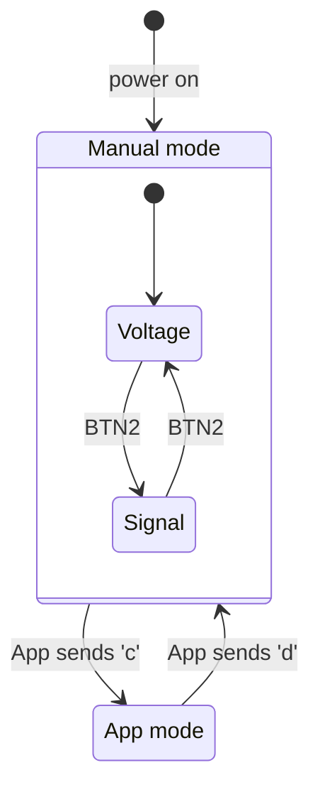
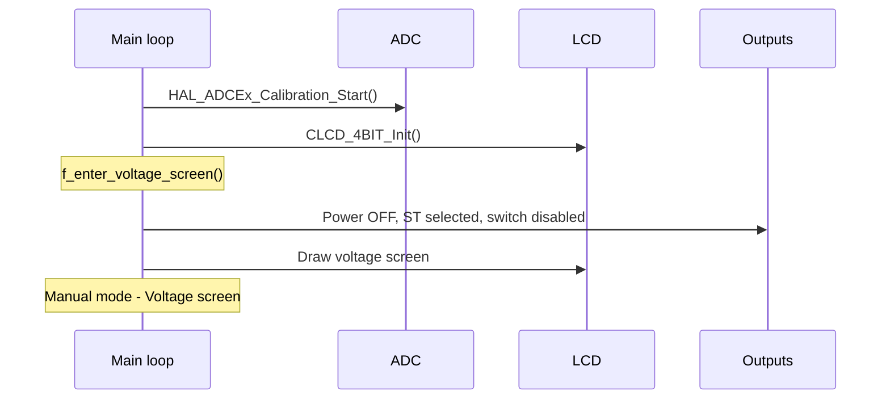
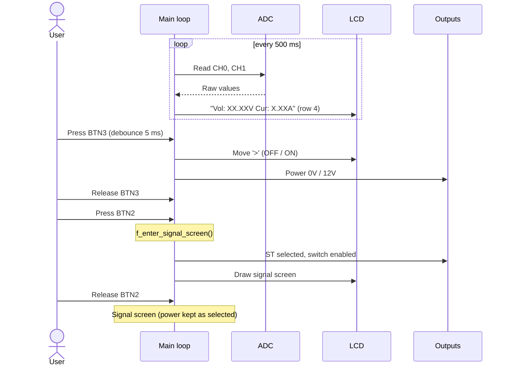
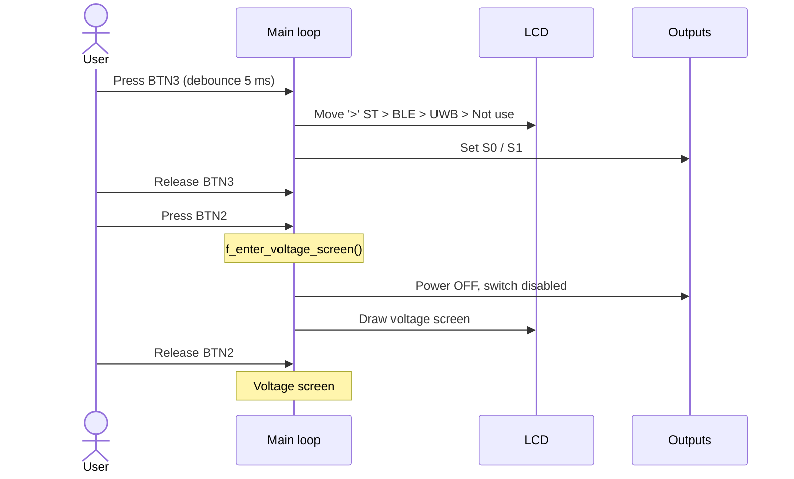
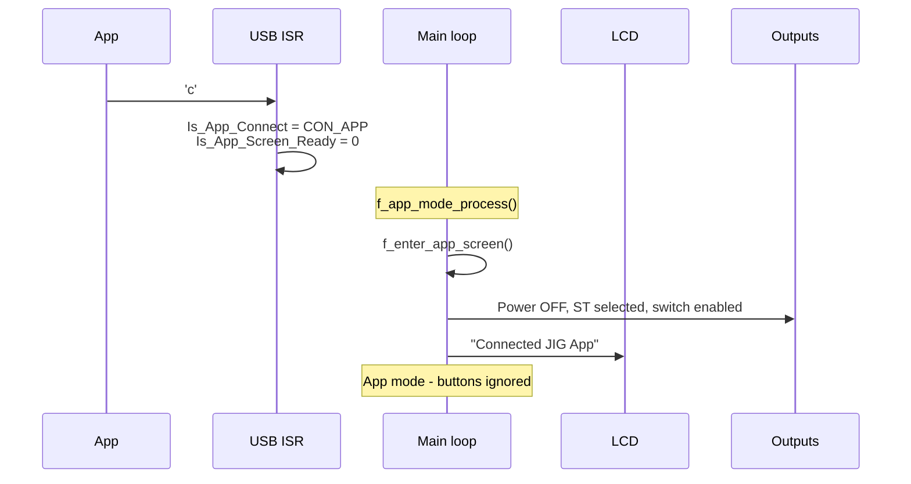
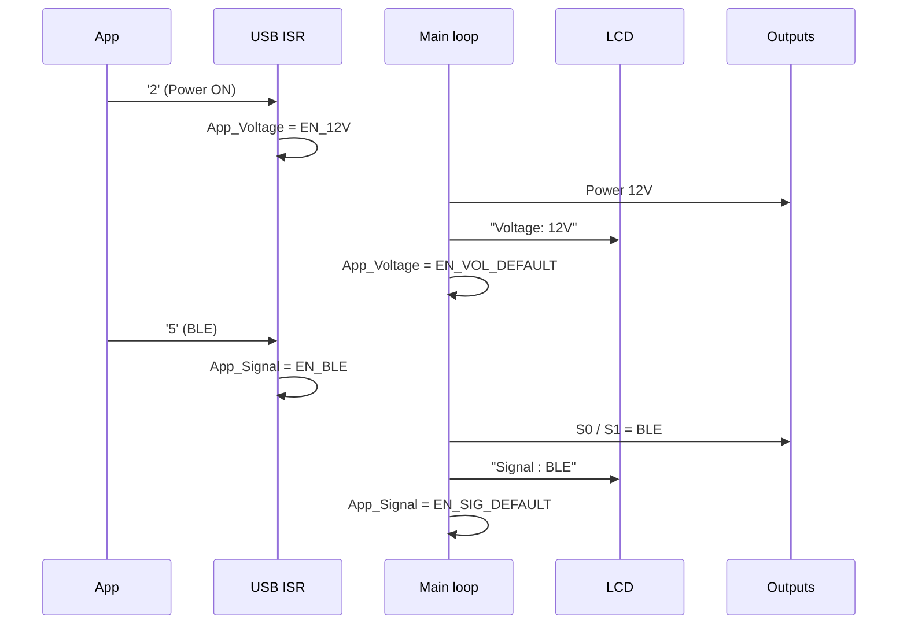
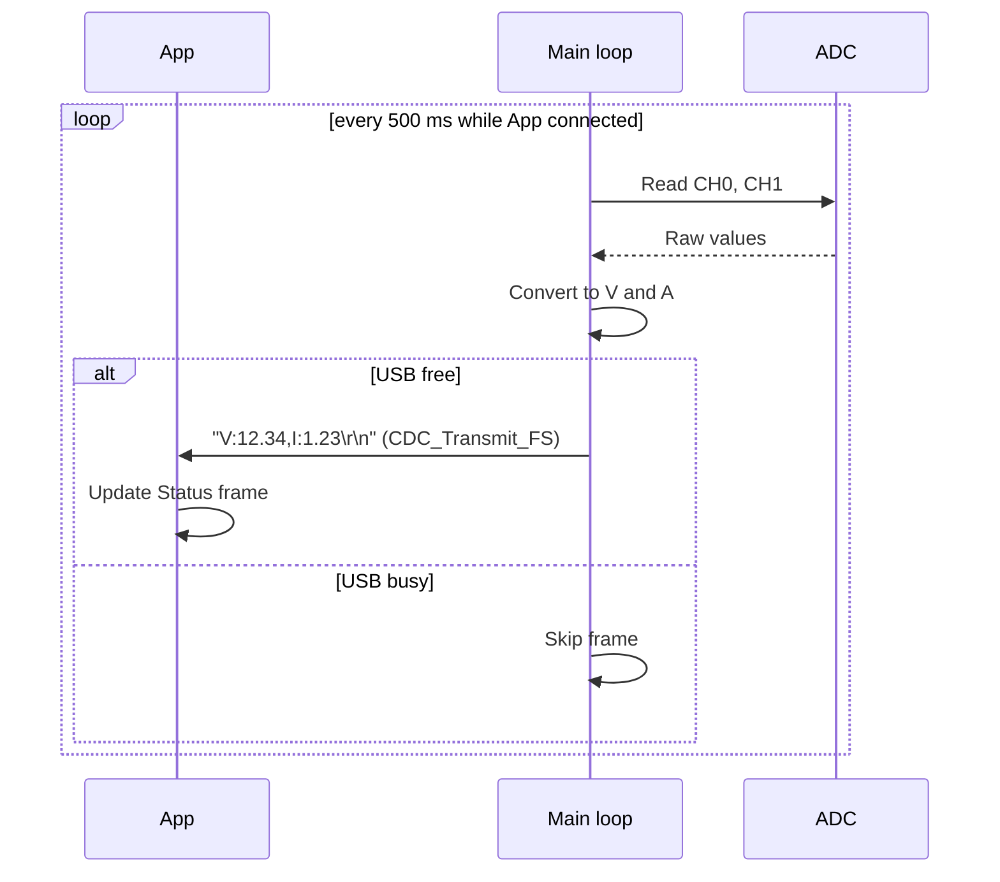
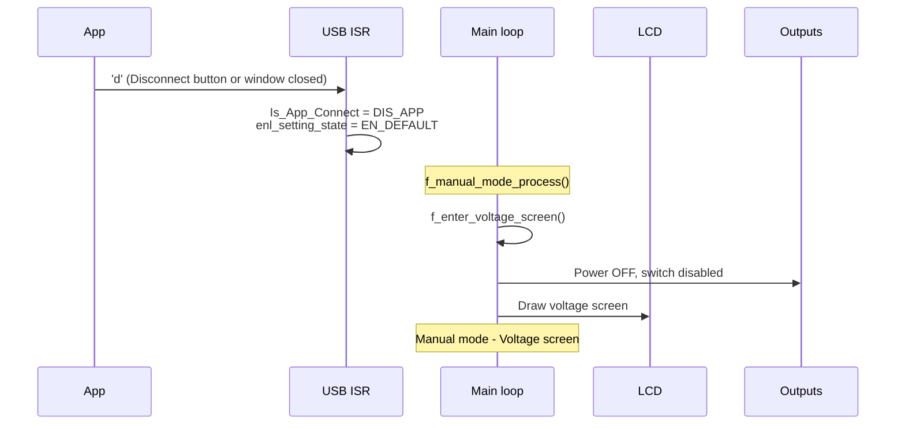

# PKM JIG – Firmware Sequence

Firmware: `04_SourceCode/PKM_JIG` (STM32F103, USB CDC).
App: `05_Tool/PKM_JIG.py`.

## Participants

| Name      | Description                                                            |
|-----------|------------------------------------------------------------------------|
| User      | Operator pressing BTN2 / BTN3 on the JIG                               |
| App       | PC tool, talks to JIG over USB virtual COM port                        |
| USB ISR   | `CDC_Receive_FS` -> `USBRxHandler` -> `f_handle_app_cmd`               |
| Main loop | `while(1)` in `main()`: `f_manual_mode_process` / `f_app_mode_process` |
| LCD       | 20x4 character LCD                                                     |
| Outputs   | Power (`EN_12V_n`, `EN_24V_n`) and JTAG mux (`JTAG_EN_n`, `S0`, `S1`)  |
| ADC       | CH0 = voltage (divider x11), CH1 = current (ACS712 5A)                 |

## Protocol

App -> JIG: 1 byte per command.

| Byte | Command        | Accepted when |
|------|----------------|---------------|
| `c`  | Connect        | Always        |
| `d`  | Disconnect     | Always        |
| `1`  | Power OFF (0V) | App connected |
| `2`  | Power ON (12V) | App connected |
| `4`  | Signal ST uC   | App connected |
| `5`  | Signal BLE     | App connected |
| `6`  | Signal UWB     | App connected |
| `7`  | Signal Not use | App connected |

JIG -> App: one text line every 500 ms while App is connected.

```
V:12.34,I:1.23\r\n
```

`V` in volt, `I` in ampere, 2 decimals.

JTAG mux select:

| Signal  | S1 | S0 |
|---------|----|----|
| ST uC   | 0  | 0  |
| BLE     | 0  | 1  |
| UWB     | 1  | 0  |
| Not use | 1  | 1  |

## Mode overview



## 1. Startup



## 2. Manual mode – Voltage screen



## 3. Manual mode – Signal screen



## 4. App connect



## 5. App control



The ISR only stores the request. The main loop applies it, so GPIO and LCD are
never driven from interrupt context.

## 6. Voltage / current reporting



## 7. App disconnect


